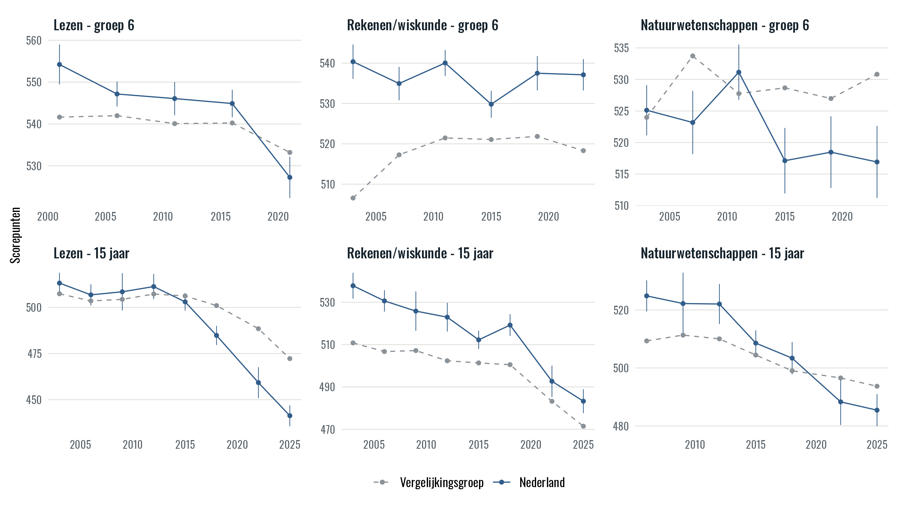
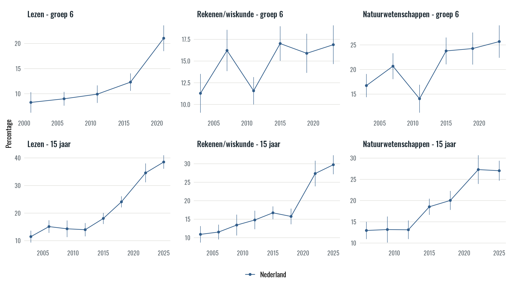
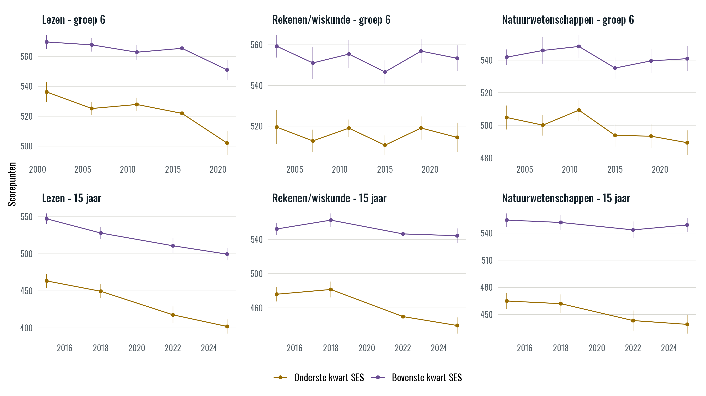
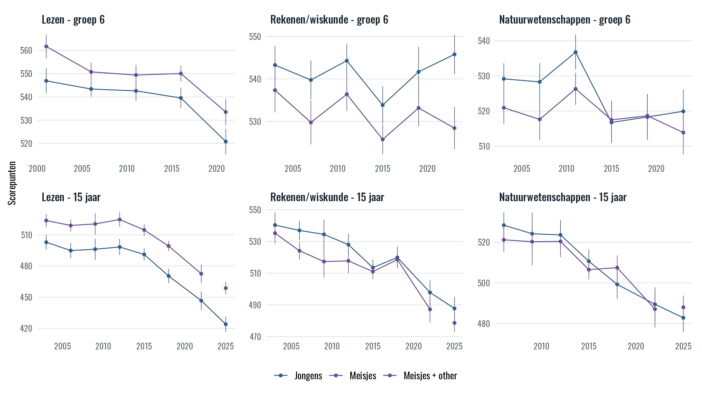
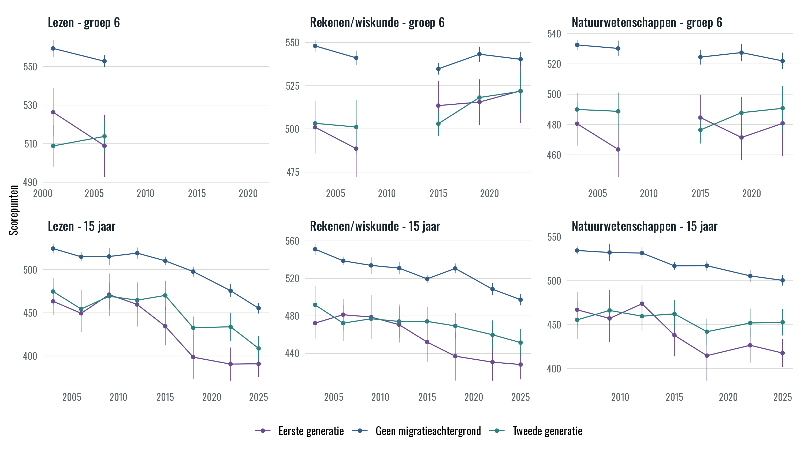
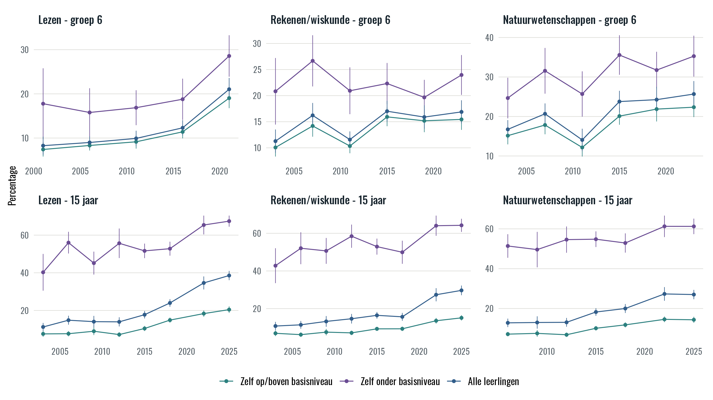

<!-- PAPER_TEXT_001 -->
Nederlandse leerprestaties, sociale verschillen en leeromgevingen

<!-- PAPER_TEXT_002 -->
PIRLS, TIMSS en PISA in een reproduceerbaar internationaal kader

<!-- PAPER_TEXT_003 -->
Kansenlab / Netherlands Opportunity Lab
Onderzoeksversie oktober 2026. Selectie: huidige 47 landen en onderwijssystemen.

## Samenvatting

<!-- PAPER_TEXT_004 -->
Dit onderzoek beschrijft de ontwikkeling van leerprestaties in Nederland, verschillen naar achtergrond en de samenstelling van de leeromgeving. Het combineert herhaalde internationale dwarsdoorsneden voor het vierde leerjaar (Nederlandse groep 6) en 15-jarigen. Lezen, rekenen/wiskunde en natuurwetenschappen worden per studie en populatie afzonderlijk geanalyseerd. Het pakket bevat een interactief dashboard, een beleidsgerichte presentatie en een volledig herleidbaar resultatengrid.

<!-- PAPER_TEXT_005 -->
De geschatte verandering in lezen in groep 6 tussen 2001 en 2021 bedraagt -27,0 PIRLS-punten. In TIMSS bedragen de veranderingen tussen 2003 en 2023 -3,2 punten voor rekenen en -8,2 punten voor natuurwetenschappen. Bij 15-jarigen bedragen de geregistreerde langetermijnveranderingen -71,8 PISA-punten voor lezen, -54,6 voor wiskunde en -39,4 voor natuurwetenschappen. Deze veranderingen betreffen verschillende perioden en schalen; zij worden niet onderling als leeftijdseffect vergeleken.

<!-- PAPER_TEXT_006 -->
Sociale verschillen worden bij de jongere leerlingen gemeten met nationale boekenkwartielen en bij PISA met een vooraf gekozen, trendvergelijkbare SES-constructie. Die constructen zijn niet uitwisselbaar. Verschillen en peerblootstelling zijn beschrijvend. Steekproefrespons, uitsluitingen, afnamemodus, ontbrekende achtergrondkenmerken en meetonzekerheid begrenzen de interpretatie.

## 1. Vraagstelling en onderzoeksopzet

<!-- PAPER_TEXT_007 -->
De centrale vraag is hoe Nederlandse leerprestaties zich door de tijd ontwikkelen, voor welke groepen verschillen zichtbaar zijn en hoe leerlingen over leeromgevingen zijn verdeeld. Het doel is een controleerbare beschrijving die dezelfde uitkomsten, definities en onzekerheid in alle producten gebruikt. De interactieve vergelijking met andere landen biedt context; zij verandert de Nederlandse doelgroep of meetjaren niet.

<!-- PAPER_TEXT_008 -->
De analyse volgt geen individuele leerlingen. Veranderingen kunnen naast onderwijs en leerprocessen ook samenhangen met veranderende populaties, selectieve deelname, meetomstandigheden en achtergrondmetingen. Het verschil tussen een jongere en oudere leeftijdsgroep is geen individuele ontwikkeling. De resultaten identificeren geen causaal beleidseffect, geen effect van ouderlijk inkomen en geen causaal effect van klasgenoten.

<!-- PAPER_TEXT_009 -->
De huidige afrondingsversie omvat 47 expliciet gekozen landen en onderwijssystemen. Van de bredere bronmatig onderzochte selectie zijn 36 systemen uitgesteld tot een latere R-run. Dat is een fasering van productie en publicatie. De toelatingseisen en historische rijke kandidatenpool zijn niet aangepast om een vooraf bepaald aantal vergelijkingslanden te bereiken.

<!-- PAPER_TEXT_010 -->
De analyse sluit aan bij de officiële PISA-, PIRLS- en TIMSS-rapportages over prestaties en verschillen tussen leerlinggroepen. Hun technische documentatie bepaalt de populaties, schalen en variantieberekening. Voor de vergelijkbaarheid van de PISA-SES-maat volgen we de expliciet gekozen methode van Cobreros en medeauteurs (2026); de numerieke overeenkomst met hun implementatie is afzonderlijk getoetst. Onze bijdrage is een consistente beschrijving van Nederland, met dezelfde definities en herleidbare cijfers in de tijdreeksen, internationale vergelijkingen en analyses van leeromgevingen. Een geharmoniseerde achtergrondmaat neemt de beperkingen van observationele vergelijkingen niet weg.

## 2. Bronnen, populaties en meetjaren

### Tabel 1. Nederlandse basisreeksen

| Studie | Populatie | Domein | Meetjaren |
| --- | --- | --- | --- |
| PIRLS | Groep 6 | Lezen | 2001, 2006, 2011, 2016, 2021 |
| PISA | 15 jaar | Lezen | 2003, 2006, 2009, 2012, 2015, 2018, 2022, 2025 |
| TIMSS | Groep 6 | Rekenen/wiskunde | 2003, 2007, 2011, 2015, 2019, 2023 |
| PISA | 15 jaar | Rekenen/wiskunde | 2003, 2006, 2009, 2012, 2015, 2018, 2022, 2025 |
| TIMSS | Groep 6 | Natuurwetenschappen | 2003, 2007, 2011, 2015, 2019, 2023 |
| PISA | 15 jaar | Natuurwetenschappen | 2006, 2009, 2012, 2015, 2018, 2022, 2025 |

Meetgolven zijn afzonderlijke afnames, geen jaarlijkse waarnemingen. Het SES-anker bij PISA begint in 2015.

<!-- PAPER_TEXT_011 -->
PIRLS meet lezen; TIMSS meet rekenen/wiskunde en natuurwetenschappen. De gebruikte IEA-populatie is het internationale vierde leerjaar, in Nederland groep 6. PISA betreft de officiële nationale doelpopulatie van schoolgaande 15-jarigen. Landen en regio’s worden niet gelijkgesteld: een subnationale steekproef wordt niet gebruikt als vervanging voor een nationale populatie in een andere studie.

<!-- PAPER_TEXT_012 -->
De broncatalogus legt voor iedere editie het officiële bestand, de bronhash, doelgroep, landidentiteit, jaar, mode en relevante kwaliteitsdocumentatie vast. Een bestandsnaam met 2025 of een zichtbaar grafiekpunt is geen bewijs van beschikbaarheid. De gebruikte PISA 2025-gegevens zijn getoetst aan de officiële databank en bijbehorende release- en kwaliteitsdocumentatie. De nog voorlopige status van onderdelen van het technische rapport blijft vermeld in het bronregister.

<!-- PAPER_TEXT_013 -->
Officiële uitsluitings- en responspercentages blijven afzonderlijk van de aantallen in onze analysegroepen. Een gewogen schatting corrigeert niet automatisch alle gevolgen van non-respons of veranderende populatiedekking. De Nederlandse cyclusgegevens staan in bijlage A en in NLD_OFFICIAL_SAMPLE_QUALITY.csv; de internationale gegevens staan in het wetenschappelijke brondossier.

## 3. Uitkomsten, achtergrondkenmerken en leeromgevingen

<!-- PAPER_TEXT_014 -->
De basis beschrijft gemiddelde prestaties, geselecteerde percentielen, de spreiding tussen het 90e en 10e percentiel, en aandelen onder het basisniveau en op hoog/gevorderd niveau. Een plausible value is een trekking uit een verdeling voor populatieschatting, geen individuele toetsscore. Alle vereiste plausible values worden daarom in iedere toepasselijke schatting verwerkt.

### Tabel 2. Gehanteerde afkappunten

| Studie / domein | Onder basisniveau | Hoog / gevorderd |
| --- | --- | --- |
| PIRLS / lezen | < 475 | ≥ 625 |
| TIMSS / beide domeinen | < 475 | ≥ 625 |
| PISA / lezen | < 407,47 | ≥ 625,61 |
| PISA / wiskunde | < 420,07 | ≥ 606,99 |
| PISA / natuurwetenschappen | < 409,54 | ≥ 633,33 |

PISA: onder niveau 2 en vanaf niveau 5. IEA: onder het Intermediate International Benchmark en vanaf het Advanced International Benchmark. Dit zijn twee verschillende afkappunten; de lage en hoge staart zijn geen complementen.

<!-- PAPER_TEXT_015 -->
Bij IEA gebruiken we het aantal boeken thuis om binnen elk land en meetjaar gewogen kwartielen te bepalen. Bij gelijke antwoorden aan een kwartielgrens worden leerlingen fractioneel toegewezen. Daardoor is het aantal leerlingen met positieve groepsdeelname niet noodzakelijk een kwart van de steekproef. De gewogen groepsmassa en de ongewogen aantallen worden afzonderlijk verantwoord.

<!-- PAPER_TEXT_016 -->
Bij PISA gebruiken we uitsluitend de gekozen viergolvenvariant met dertien gemeenschappelijke items uit de implementatie van Cobreros en medeauteurs (2026). Auteurscode, kalibratiesteekproef, itemparameters, schaaltoepassing en regressie-imputatie zijn gepind en numeriek gecontroleerd. De vier golven zijn 2015, 2018, 2022 en 2025. De oudere tweegolfvariant en een extra officiële-ESCS-robuustheidsanalyse zijn niet gebruikt. Het kalibratiepanel van de auteurs bepaalt niet de dashboardlanden.

<!-- PAPER_TEXT_017 -->
De vaste kalibratie wordt ook toegepast buiten de oorspronkelijke kalibratiesteekproef. Controle van veldkoppelingen, scoreberekening en ontbrekende waarden bewijst numerieke reproduceerbaarheid, maar bewijst geen meetinvariantie of willekeurige ontbrekendheid in die aanvullende landen. Onzekerheidsmarges zijn conditioneel op deze constructie en op de vastgezette kalibratieparameters.

<!-- PAPER_TEXT_018 -->
Geslacht wordt aan de hand van de officiële veldlabels per broneditie gekoppeld. Afzonderlijke meisjes blijven afzonderlijk waar zij worden waargenomen. Alleen waar de openbare bron meisjes niet apart van “Other” bevat, wordt de expliciet goedgekeurde categorie “Meisjes + other” gebruikt. Die categorie houdt een eigen definitie en zichtbaar label; zij wordt niet als identiek aan een afzonderlijke meisjescategorie behandeld.

<!-- PAPER_TEXT_019 -->
Migratieachtergrond heeft drie afzonderlijke definities: minstens één in het buitenland geboren ouder; beide ouders in het buitenland geboren; en eerste of tweede generatie afzonderlijk. De laatste definitie gebruikt ook de geboorteplaats van de leerling. Een derde generatie wordt niet afgeleid. De noemer is per definitie bepaald door de beschikbare geboorteplaatsen: onbekende geboorteplaatsen zijn geen geboorten in het land van afname.

<!-- PAPER_TEXT_020 -->
Taalgebruik thuis wordt volgens de bronvraag onderscheiden. Een frequentie van de toetstaal thuis is een ander construct dan uitsluitend de opgegeven thuistaal. Labels en breuken in vergelijkbaarheid worden behouden. De afgewezen interactie tussen taal en migratie wordt niet toegevoegd.

<!-- PAPER_TEXT_021 -->
Peerblootstelling is het leerlinggewogen aandeel van een kenmerk bij andere leerlingen in dezelfde beschikbare leeromgeving, met uitsluiting van de leerling zelf. IEA gebruikt de geïdentificeerde klas; PISA gebruikt waar beschikbaar het onderwijsprogramma binnen de school. Dat laatste is geen volledige klasidentificatie. De gehele school vormt een afzonderlijke uitkomst. Ontbrekende unitcodes en eenheden zonder andere geldige leerlingen leveren geen kunstmatig nulpercentage op.

<!-- PAPER_TEXT_022 -->
Zowel peers onder basisniveau als hoog vaardige peers zijn opgenomen. De groepsindeling op eigen vaardigheid en de peeruitkomst worden per plausible value bepaald. De noemers gebruiken waargenomen kenmerken en de betreffende leerlinggewichten. De school- en klasvarianten van prestatie- en SES-variantie zijn beschrijvende spreidingsaandelen; zij worden niet als schoolkwaliteit of als schatting van een causaal schooleffect geïnterpreteerd.

## 4. Weging, onzekerheid en vergelijkingen

<!-- PAPER_TEXT_023 -->
PISA-schattingen gebruiken het studentgewicht en alle 80 BRR-replicatiegewichten, met Fay-factor 0,5 en de bijbehorende variantiefactor 1/20. Bij de oudere gebruikte cycli worden vijf plausible values verwerkt en vanaf 2015 tien. PIRLS en TIMSS gebruiken de officiële studentgewichten, vijf plausible values en het bijbehorende cyclusgebonden jackknife-ontwerp. Variantie wordt gepoold over de plausible values volgens de bronmethode.

<!-- PAPER_TEXT_024 -->
Kloven worden binnen dezelfde replicaties en plausible values berekend. Hun standaardfout omvat daardoor de gezamenlijke covariantie van de twee groepen. Het optellen van afzonderlijke groepsvarianties zonder die covariantie is hier geen vervanging. Bij de SES-indeling worden de relevante gewogen groepen ook binnen de replicaties opgebouwd.

<!-- PAPER_TEXT_025 -->
Getoonde puntintervallen zijn normaalbenaderingen van 95%: schatting plus of min 1,96 maal de gecertificeerde standaardfout. Zij beschrijven steekproef- en plausible-value-onzekerheid, geen spreiding van individuele leerlingen en geen volledige correctie voor non-respons of meetproblemen. Overlap van twee puntintervallen is geen toets van een verandering. Als een bronresultaat een proportie is, worden de schatting en standaardfout voor de procentweergave met 100 vermenigvuldigd. Resultaten die al percentages zijn, blijven ongewijzigd. Alle opgeslagen waarden behouden volledige precisie.

<!-- PAPER_TEXT_026 -->
Voor de drie geregistreerde PISA-langetermijnveranderingen wordt de officiële extra onzekerheid van de koppeling tussen het begin- en eindjaar toegevoegd aan de variantie van het verschil. Die linking error betreft de vergelijkbaarheid van scores over afnames: ook als de steekproeven groot zijn, is de verbinding tussen twee meetschalen niet exact. Zij verandert de geschatte verandering niet, maar vergroot de onzekerheidsmarge. De drie p-waarden krijgen gezamenlijk een Holm-correctie.

<!-- PAPER_TEXT_027 -->
Bij de IEA-langetermijnveranderingen is de beschikbare steekproef/PV-onzekerheid niet aangevuld met een volledig gekwantificeerde langetermijn-linkingvariantie. Deze veranderingen en hun conditionele intervallen worden uitsluitend beschrijvend gerapporteerd. Er wordt geen formele significantieclaim aan verbonden. De twaalf Nederlandse paperclaims zijn geregistreerd nadat resultaten beschikbaar waren, vóór het schrijven van de paper; dit is geen prospectieve preregistratie. Wijzigingen in claims of ouderschattingen vereisen een nieuwe Q08-controle.

<!-- PAPER_TEXT_028 -->
Voor openbare figuren vereist het project ten minste dertig doelgroepleerlingen in elk noodzakelijk onderdeel en iedere vereiste plausible value. Waar schoolidentificaties worden waargenomen, zijn ten minste vijf waargenomen scholen vereist. Ontbrekende schoolidentificatie is geen waarneming van nul scholen en wordt afzonderlijk verantwoord. Een tekort blijft een kwaliteitsvoorbehoud: de taak en gecertificeerde schatting blijven bewaard, maar het punt komt niet in een figuur, referentiegemiddelde of rang. Voldoende aantallen zijn op zichzelf geen bewijs van representativiteit. Een geldige nul met voldoende ondersteuning blijft wel een resultaat.

<!-- PAPER_TEXT_029 -->
Een land kan voor een bepaalde leeftijd-domeincombinatie worden toegelaten na minstens drie vergelijkbare meetgolven. Een referentieland moet bovendien alle jaren van het hoofdland en alle samen getoonde groepen en leeromgevingen in die figuur volledig dekken. De groep blijft binnen de figuur gelijk. Tussen figuren mogen groepen verschillen. Jaren, groepen of de hoofdlandpopulatie worden niet verkort om een vergelijking mogelijk te maken.

<!-- PAPER_TEXT_030 -->
De standaard kiest de passende landen uit de historisch vastgelegde rijke OESO-kandidatenpool en sluit het hoofdland uit. Ieder referentieland telt even zwaar. Dit is een gemiddelde van landen, niet een gepoold leerlinggemiddelde. Een lege groep blijft leeg. De huidige 47-landenafbakening geldt ook voor referenties; uitgestelde landen tellen nu niet mee.

<!-- PAPER_TEXT_031 -->
Rangen worden berekend op de ongeronde uitkomsten binnen het hoofdland plus dezelfde geselecteerde referentielanden. Exact gelijke waarden krijgen de gemiddelde rang. Voor scores en hoge vaardigheid komt de hoogste waarde eerst; voor het aandeel onder basisniveau, spreiding en de absolute grootte van een kloof de laagste. Het teken van een kloof blijft bewaard bij de bronwaarde. Rangen zijn beschrijvend en hebben geen overgenomen score-standaardfout. De internationale groep krijgt geen eigen ranglijn.

## 5. Nederlandse resultaten

### Tabel 3. Geregistreerde langetermijnveranderingen

| Studie / domein | Periode | Verandering | 95%-interval | Interpretatie |
| --- | --- | --- | --- | --- |
| PIRLS / lezen | 2001-2021 | -27,0 | -33,8 tot -20,1 | Conditioneel; beschrijvend |
| TIMSS / rekenen/wiskunde | 2003-2023 | -3,2 | -9,0 tot 2,5 | Conditioneel; beschrijvend |
| TIMSS / natuurwetenschappen | 2003-2023 | -8,2 | -15,2 tot -1,2 | Conditioneel; beschrijvend |
| PISA / lezen | 2003-2025 | -71,8 | -85,0 tot -58,6 | Inclusief linking |
| PISA / rekenen/wiskunde | 2003-2025 | -54,6 | -68,5 tot -40,6 | Inclusief linking |
| PISA / natuurwetenschappen | 2006-2025 | -39,4 | -51,6 tot -27,2 | Inclusief linking |

Eenheden: punten op de eigen studieschaal. PISA: drie tests, Holm-gecorrigeerde p < 0,001. IEA: geen formele trendtoets.

<!-- PAPER_TEXT_032 -->
De leesprestaties dalen tussen begin- en eindjaar in beide geregistreerde Nederlandse leeftijdspopulaties. De TIMSS-puntverandering voor rekenen is klein vergeleken met de omvang van het conditionele interval. Dat laat geen stellige conclusie over een verandering toe. De drie PISA-trendtoetsen wijzen onder de gebruikte steekproef- en linkingveronderstellingen op lagere eindjaarsgemiddelden. Dit ontslaat de interpretatie niet van de nationale kwaliteitsvoorbehouden.

<!-- PAPER_TEXT_033 -->
De aandelen onder basisniveau geven een andere samenvatting dan het gemiddelde. Een beweging van het gemiddelde legt niet vast hoeveel leerlingen een afkappunt passeren; dat hangt ook af van de verdeling. De tweede, hogere grens beschrijft de bovenste vaardigheidsgroep. Het aandeel onder basisniveau is daarom niet het complement van het aandeel hoog/gevorderd.

### Tabel 4. SES-kloof in het laatste meetjaar

| Studie / domein | Jaar | Q4 min Q1 | 95%-interval |
| --- | --- | --- | --- |
| PIRLS / lezen | 2021 | 48,9 | 39,8 tot 58,1 |
| TIMSS / rekenen/wiskunde | 2023 | 38,9 | 30,0 tot 47,9 |
| TIMSS / natuurwetenschappen | 2023 | 51,6 | 43,5 tot 59,6 |
| PISA / lezen | 2025 | 97,5 | 85,1 tot 109,9 |
| PISA / rekenen/wiskunde | 2025 | 104,8 | 92,3 tot 117,4 |
| PISA / natuurwetenschappen | 2025 | 109,6 | 97,0 tot 122,3 |

Joint-PV/replicatie-intervallen. Boekenkwartielen (IEA) en de gekozen Cobreros-SES (PISA) meten verschillende constructen. Geen vergelijking van causale of leeftijdseffecten.

<!-- PAPER_TEXT_034 -->
In alle zes laatste Nederlandse combinaties ligt de geschatte gemiddelde prestatie in het bovenste SES-kwartiel hoger dan in het onderste. De tabel kwantificeert dat verschil binnen de betreffende studie en gekozen maat. Zij laat niet zien wat de prestatie van een leerling zou zijn bij een ander gezinsinkomen, en de grotere PISA-puntverschillen zijn geen bewijs dat ongelijkheid tussen de twee leeftijden is toegenomen.

<!-- PAPER_TEXT_035 -->
Uitsplitsingen naar geslacht, thuistaal en migratieachtergrond beschrijven groepen met verschillende samenstelling en soms verschillende respons. Zij worden niet als afzonderlijke verklarende effecten bij elkaar opgeteld. De definities voor minstens één buitenlandse ouder, beide buitenlandse ouders en migratiegeneratie blijven onderscheiden in dashboard en tabellen.

<!-- PAPER_TEXT_036 -->
Verschillen in peerblootstelling laten zien met welke andere leerlingen de waargenomen groepen dezelfde leeromgeving delen. Zelfuitsluiting voorkomt de mechanische bijdrage van het eigen kenmerk aan het peeraandeel. Zij lost selectie tussen scholen, programma’s en klassen niet op. Zowel de lage als de hoge vaardigheidsstaart is beschikbaar in de presentatie en het dashboard; de exacte cijfers per meetgolf staan in de resultaatbijlage.

### 5.1. Verschillen tussen scholen

### Tabel 5. Aandeel van de geobserveerde variantie tussen scholen

| Studie / jaar | Uitkomst | Aandeel (%) | SE |
| --- | --- | --- | --- |
| PIRLS 2021 | Lezen | 18,6 | 2,4 |
| PISA 2025 | Rekenen/wiskunde | 61,6 | 1,3 |
| PISA 2025 | Lezen | 54,6 | 1,5 |
| PISA 2025 | Natuurwetenschappen | 59,3 | 1,4 |
| TIMSS 2023 | Rekenen/wiskunde | 16,9 | 1,7 |
| TIMSS 2023 | Natuurwetenschappen | 21,1 | 2,0 |
| PIRLS 2021 | Boeken thuis | 15,0 | 1,6 |
| PISA 2025 | Cobreros-SES | 25,0 | 1,7 |
| TIMSS 2023 | Boeken thuis | 10,6 | 1,1 |

Laatste meetjaar per construct; A11 en A13. Gewogen beschrijvende decompositie. De brondefinitie en de schaal blijven per rij afzonderlijk. Volledige reeksen en klasvarianten staan in de resultaatbijlage.

<!-- PAPER_TEXT_037 -->
Deze aandelen beschrijven hoeveel van de geobserveerde spreiding samenhangt met verschillen tussen de gewogen schoolgemiddelden. Zij omvatten selectie van leerlingen en verschillen in samenstelling. Een groot aandeel is daarom geen schatting van het aandeel dat scholen veroorzaken en ook geen rangorde van schoolkwaliteit. Bij PISA kan de nationale indeling naar onderwijsprogramma samenhangen met de verdeling over scholen. De boekencategorieën bij IEA en de gekalibreerde PISA-SES zijn verschillende schalen; hun variantieaandelen worden niet als dezelfde grootheid door de leeftijden heen verbonden. Klasvarianten blijven beperkt tot bronnen met vergelijkbare echte klasidentificaties.

## 6. Interpretatie en beperkingen

<!-- PAPER_TEXT_038 -->
De beschrijving geeft aanleiding om de ontwikkeling van lezen en de aanhoudende verschillen tussen sociale groepen afzonderlijk te volgen. Zij biedt geen identificatie van de bijdrage van één hervorming, schooltype, digitale afname of bevolkingsverandering. Een passende internationale referentie helpt het Nederlandse verloop in context te plaatsen, maar is geen controlegroep in een causaal onderzoeksontwerp.

<!-- PAPER_TEXT_039 -->
De belangrijkste beperkingen liggen in de doelpopulatie en deelname per cyclus, de constructie en ontbrekendheid van achtergrondkenmerken, de gekalibreerde SES-schaal buiten haar ontwikkelsteekproef en de onvolledig gekwantificeerde linking-onzekerheid bij lange IEA-vergelijkingen. Een kleine standaardfout of hoge rang corrigeert deze beperkingen niet. De verschillende IEA Home-SES-schalen zijn daarom niet tot een historische reeks samengevoegd.

<!-- PAPER_TEXT_040 -->
Een volledig afgehandeld resultatengrid betekent dat elk gekozen doel óf een gecertificeerde schatting óf een onderbouwde onbeschikbaarheidsreden heeft. Het betekent niet dat alle 47 landen voor ieder uitkomsttype een complete reeks hebben. Bronafwezigheid, niet-afgenomen vragenlijsten, een nog niet bestaande schaal en een onbruikbare analysegroep zijn afzonderlijke hoofdredenen. Kwaliteitsbeperkingen worden daar niet mee vermengd.

## 7. Reproduceerbaarheid

<!-- PAPER_TEXT_041 -->
Code, keuzes, bronidentiteiten en resultaten worden als afzonderlijke maar gekoppelde versies bewaard. De exportcommit is niet automatisch de commit die een schatting produceerde. Iedere cel houdt haar taakcontract, broneditie, methode, producent, onzekerheidsregels en resultaat- en certificaathash. Afgeleide kloven, complementen, landenmiddelen en rangen houden hun exacte ouderschattingen.

<!-- PAPER_TEXT_042 -->
De R-keten gebruikt START.R en RUN.R met de bestaande volgorde fixed-audit, fixed-produce en fixed-finalize. Een identieke hervatting hergebruikt geldige cellen; een gewijzigde bron, methode of relevante configuratie maakt de betreffende afhankelijkheden ongeldig. Bronreplicatie, inspectie van opgeslagen resultaten en reconstructie van producten uit aggregaten zijn verschillende routes. De README rapporteert welke routes werkelijk op Windows en Linux zijn uitgevoerd.

<!-- PAPER_TEXT_043 -->
De getallen in deze paper zijn gebonden aan resultaatcommit d36eea18980101ce354ebb05ce5f5d91280a70f8. De bijgeleverde PRODUCT_POINT_LINEAGE.json en PAPER_PRODUCT_TRACE.json koppelen figuren, tabellen en claims aan de gebruikte resultaten. Volledige numerieke precisie blijft in de gegevens; tabellen ronden alleen voor leesbaarheid af.

---

## Bijlage A. Steekproeven en analysegroepen

### A1. Officiële Nederlandse cycluskenmerken

| Studie | Jaar | Mode | Schoolrespons vóór vervanging (%) | Uitsluiting (%) | Kwaliteitsnotitie |
| --- | --- | --- | --- | --- | --- |
| PIRLS | 2001 | Papier | 53,0 | 3,7 | Schoolrespons vóór vervanging < 85% |
| PIRLS | 2006 | Papier | 70,0 | 3,6 | Schoolrespons vóór vervanging < 85% |
| PIRLS | 2011 | Papier | 68,0 | 3,7 | Schoolrespons vóór vervanging < 85% |
| PIRLS | 2016 | Papier | 69,0 | 3,1 | Schoolrespons vóór vervanging < 85% |
| PIRLS | 2021 | Papier | 44,0 | 5,1 | Uitsluiting > 5%; Schoolrespons vóór vervanging < 85% |
| TIMSS | 2003 | Papier | 52,0 | 5,2 | Uitsluiting > 5%; Schoolrespons vóór vervanging < 85% |
| TIMSS | 2007 | Papier | 48,0 | 4,8 | Schoolrespons vóór vervanging < 85% |
| TIMSS | 2011 | Papier | 49,0 | 4,0 | Schoolrespons vóór vervanging < 85% |
| TIMSS | 2015 | Papier | 48,0 | 3,2 | Schoolrespons vóór vervanging < 85% |
| TIMSS | 2019 | Digitaal, officiële trendkoppeling | 46,0 | 3,5 | Schoolrespons vóór vervanging < 85%; Gecombineerde respons < 75% |
| TIMSS | 2023 | Digitaal, officiële trendkoppeling | 54,0 | 4,4 | Schoolrespons vóór vervanging < 85% |
| PISA | 2003 | Papier | 82,6 | 1,9 | Schoolrespons vóór vervanging < 85% |
| PISA | 2006 | Papier | 75,7 | 0,1 | Schoolrespons vóór vervanging < 85% |
| PISA | 2009 | Papier | 80,4 | 3,5 | Schoolrespons vóór vervanging < 85% |
| PISA | 2012 | Papier | 75,3 | 4,4 | Schoolrespons vóór vervanging < 85% |
| PISA | 2015 | Computer | 63,3 | 3,7 | Schoolrespons vóór vervanging < 85% |
| PISA | 2018 | Computer | 61,0 | 6,2 | Uitsluiting > 5%; Schoolrespons vóór vervanging < 85%; Doelpopulatiedekking < 95% |
| PISA | 2022 | Computer | 65,5 | 8,4 | Uitsluiting > 5%; Schoolrespons vóór vervanging < 85%; Doelpopulatiedekking < 95% |
| PISA | 2025 | Computer | 65,6 | 9,3 | Uitsluiting > 5%; Schoolrespons vóór vervanging < 85%; Leerlingrespons onder de studiedrempel; Doelpopulatiedekking < 95% |

Blanco officiële velden betekenen niet gerapporteerd in de gebruikte bron. De volledige respons- en populatiegegevens staan in NLD_OFFICIAL_SAMPLE_QUALITY.csv.

### A2. SES-dekking en groepen

| Studie | Jaar | Domein | Groep | Geldige SES (n) | Gewogen dekking (%) | Groep (n) | Complete PV (n) |
| --- | --- | --- | --- | --- | --- | --- | --- |
| PIRLS | 2001 | Lezen | Q1 | 3.999 | 97,3 | 1.441 | 1.441 |
| PIRLS | 2001 | Lezen | Q4 | 3.999 | 97,3 | 1.112 | 1.112 |
| PIRLS | 2001 | Lezen | Q4 min Q1 | 3.999 | 97,3 | 2.553 | 2.553 |
| PIRLS | 2006 | Lezen | Q1 | 4.082 | 98,0 | 1.427 | 1.427 |
| PIRLS | 2006 | Lezen | Q4 | 4.082 | 98,0 | 1.129 | 1.129 |
| PIRLS | 2006 | Lezen | Q4 min Q1 | 4.082 | 98,0 | 2.556 | 2.556 |
| PIRLS | 2011 | Lezen | Q1 | 3.941 | 98,7 | 1.304 | 1.304 |
| PIRLS | 2011 | Lezen | Q4 | 3.941 | 98,7 | 1.076 | 1.076 |
| PIRLS | 2011 | Lezen | Q4 min Q1 | 3.941 | 98,7 | 2.380 | 2.380 |
| PIRLS | 2016 | Lezen | Q1 | 4.148 | 98,6 | 1.464 | 1.464 |
| PIRLS | 2016 | Lezen | Q4 | 4.148 | 98,6 | 2.684 | 2.684 |
| PIRLS | 2016 | Lezen | Q4 min Q1 | 4.148 | 98,6 | 4.148 | 4.148 |
| PIRLS | 2021 | Lezen | Q1 | 4.228 | 98,0 | 1.722 | 1.722 |
| PIRLS | 2021 | Lezen | Q4 | 4.228 | 98,0 | 2.506 | 2.506 |
| PIRLS | 2021 | Lezen | Q4 min Q1 | 4.228 | 98,0 | 4.228 | 4.228 |
| PISA | 2015 | Rekenen/wisk. | Q1 | 5.322 | 98,9 | 1.311 | 1.311 |
| PISA | 2015 | Rekenen/wisk. | Q4 | 5.322 | 98,9 | 1.335 | 1.335 |
| PISA | 2015 | Rekenen/wisk. | Q4 min Q1 | 5.322 | 98,9 | 2.646 | 2.646 |
| PISA | 2015 | Lezen | Q1 | 5.322 | 98,9 | 1.311 | 1.311 |
| PISA | 2015 | Lezen | Q4 | 5.322 | 98,9 | 1.335 | 1.335 |
| PISA | 2015 | Lezen | Q4 min Q1 | 5.322 | 98,9 | 2.646 | 2.646 |
| PISA | 2015 | Natuurwet. | Q1 | 5.322 | 98,9 | 1.311 | 1.311 |
| PISA | 2015 | Natuurwet. | Q4 | 5.322 | 98,9 | 1.335 | 1.335 |
| PISA | 2015 | Natuurwet. | Q4 min Q1 | 5.322 | 98,9 | 2.646 | 2.646 |
| PISA | 2018 | Rekenen/wisk. | Q1 | 4.655 | 97,6 | 1.204 | 1.204 |
| PISA | 2018 | Rekenen/wisk. | Q4 | 4.655 | 97,6 | 1.145 | 1.145 |
| PISA | 2018 | Rekenen/wisk. | Q4 min Q1 | 4.655 | 97,6 | 2.349 | 2.349 |
| PISA | 2018 | Lezen | Q1 | 4.655 | 97,6 | 1.204 | 1.204 |
| PISA | 2018 | Lezen | Q4 | 4.655 | 97,6 | 1.145 | 1.145 |
| PISA | 2018 | Lezen | Q4 min Q1 | 4.655 | 97,6 | 2.349 | 2.349 |
| PISA | 2018 | Natuurwet. | Q1 | 4.655 | 97,6 | 1.204 | 1.204 |
| PISA | 2018 | Natuurwet. | Q4 | 4.655 | 97,6 | 1.145 | 1.145 |
| PISA | 2018 | Natuurwet. | Q4 min Q1 | 4.655 | 97,6 | 2.349 | 2.349 |
| PISA | 2022 | Rekenen/wisk. | Q1 | 4.857 | 96,0 | 1.242 | 1.242 |
| PISA | 2022 | Rekenen/wisk. | Q4 | 4.857 | 96,0 | 1.185 | 1.185 |
| PISA | 2022 | Rekenen/wisk. | Q4 min Q1 | 4.857 | 96,0 | 2.427 | 2.427 |
| PISA | 2022 | Lezen | Q1 | 4.857 | 96,0 | 1.242 | 1.242 |
| PISA | 2022 | Lezen | Q4 | 4.857 | 96,0 | 1.185 | 1.185 |
| PISA | 2022 | Lezen | Q4 min Q1 | 4.857 | 96,0 | 2.427 | 2.427 |
| PISA | 2022 | Natuurwet. | Q1 | 4.857 | 96,0 | 1.242 | 1.242 |
| PISA | 2022 | Natuurwet. | Q4 | 4.857 | 96,0 | 1.185 | 1.185 |
| PISA | 2022 | Natuurwet. | Q4 min Q1 | 4.857 | 96,0 | 2.427 | 2.427 |
| PISA | 2025 | Rekenen/wisk. | Q1 | 6.071 | 91,9 | 1.469 | 1.469 |
| PISA | 2025 | Rekenen/wisk. | Q4 | 6.071 | 91,9 | 1.580 | 1.580 |
| PISA | 2025 | Rekenen/wisk. | Q4 min Q1 | 6.071 | 91,9 | 3.049 | 3.049 |
| PISA | 2025 | Lezen | Q1 | 6.071 | 91,9 | 1.469 | 1.469 |
| PISA | 2025 | Lezen | Q4 | 6.071 | 91,9 | 1.580 | 1.580 |
| PISA | 2025 | Lezen | Q4 min Q1 | 6.071 | 91,9 | 3.049 | 3.049 |
| PISA | 2025 | Natuurwet. | Q1 | 6.071 | 91,9 | 1.469 | 1.469 |
| PISA | 2025 | Natuurwet. | Q4 | 6.071 | 91,9 | 1.580 | 1.580 |
| PISA | 2025 | Natuurwet. | Q4 min Q1 | 6.071 | 91,9 | 3.049 | 3.049 |
| TIMSS | 2003 | Rekenen/wisk. | Q1 | 2.878 | 98,0 | 844 | 844 |
| TIMSS | 2003 | Rekenen/wisk. | Q4 | 2.878 | 98,0 | 949 | 949 |
| TIMSS | 2003 | Rekenen/wisk. | Q4 min Q1 | 2.878 | 98,0 | 1.793 | 1.793 |
| TIMSS | 2003 | Natuurwet. | Q1 | 2.878 | 98,0 | 844 | 844 |
| TIMSS | 2003 | Natuurwet. | Q4 | 2.878 | 98,0 | 949 | 949 |
| TIMSS | 2003 | Natuurwet. | Q4 min Q1 | 2.878 | 98,0 | 1.793 | 1.793 |
| TIMSS | 2007 | Rekenen/wisk. | Q1 | 3.199 | 95,8 | 1.087 | 1.087 |
| TIMSS | 2007 | Rekenen/wisk. | Q4 | 3.199 | 95,8 | 813 | 813 |
| TIMSS | 2007 | Rekenen/wisk. | Q4 min Q1 | 3.199 | 95,8 | 1.900 | 1.900 |
| TIMSS | 2007 | Natuurwet. | Q1 | 3.199 | 95,8 | 1.087 | 1.087 |
| TIMSS | 2007 | Natuurwet. | Q4 | 3.199 | 95,8 | 813 | 813 |
| TIMSS | 2007 | Natuurwet. | Q4 min Q1 | 3.199 | 95,8 | 1.900 | 1.900 |
| TIMSS | 2011 | Rekenen/wisk. | Q1 | 3.169 | 98,1 | 1.119 | 1.119 |
| TIMSS | 2011 | Rekenen/wisk. | Q4 | 3.169 | 98,1 | 807 | 807 |
| TIMSS | 2011 | Rekenen/wisk. | Q4 min Q1 | 3.169 | 98,1 | 1.926 | 1.926 |
| TIMSS | 2011 | Natuurwet. | Q1 | 3.169 | 98,1 | 1.119 | 1.119 |
| TIMSS | 2011 | Natuurwet. | Q4 | 3.169 | 98,1 | 807 | 807 |
| TIMSS | 2011 | Natuurwet. | Q4 min Q1 | 3.169 | 98,1 | 1.926 | 1.926 |
| TIMSS | 2015 | Rekenen/wisk. | Q1 | 4.346 | 96,8 | 1.629 | 1.629 |
| TIMSS | 2015 | Rekenen/wisk. | Q4 | 4.346 | 96,8 | 2.717 | 2.717 |
| TIMSS | 2015 | Rekenen/wisk. | Q4 min Q1 | 4.346 | 96,8 | 4.346 | 4.346 |
| TIMSS | 2015 | Natuurwet. | Q1 | 4.346 | 96,8 | 1.629 | 1.629 |
| TIMSS | 2015 | Natuurwet. | Q4 | 4.346 | 96,8 | 2.717 | 2.717 |
| TIMSS | 2015 | Natuurwet. | Q4 min Q1 | 4.346 | 96,8 | 4.346 | 4.346 |
| TIMSS | 2019 | Rekenen/wisk. | Q1 | 3.255 | 97,2 | 1.355 | 1.355 |
| TIMSS | 2019 | Rekenen/wisk. | Q4 | 3.255 | 97,2 | 1.900 | 1.900 |
| TIMSS | 2019 | Rekenen/wisk. | Q4 min Q1 | 3.255 | 97,2 | 3.255 | 3.255 |
| TIMSS | 2019 | Natuurwet. | Q1 | 3.255 | 97,2 | 1.355 | 1.355 |
| TIMSS | 2019 | Natuurwet. | Q4 | 3.255 | 97,2 | 1.900 | 1.900 |
| TIMSS | 2019 | Natuurwet. | Q4 min Q1 | 3.255 | 97,2 | 3.255 | 3.255 |
| TIMSS | 2023 | Rekenen/wisk. | Q1 | 3.343 | 94,9 | 1.342 | 1.342 |
| TIMSS | 2023 | Rekenen/wisk. | Q4 | 3.343 | 94,9 | 875 | 875 |
| TIMSS | 2023 | Rekenen/wisk. | Q4 min Q1 | 3.343 | 94,9 | 2.217 | 2.217 |
| TIMSS | 2023 | Natuurwet. | Q1 | 3.343 | 94,9 | 1.342 | 1.342 |
| TIMSS | 2023 | Natuurwet. | Q4 | 3.343 | 94,9 | 875 | 875 |
| TIMSS | 2023 | Natuurwet. | Q4 min Q1 | 3.343 | 94,9 | 2.217 | 2.217 |

Q1: onderste kwart; Q4: bovenste kwart. Natuurwet.: natuurwetenschappen. n is ongewogen; positieve fractionele boekenlidmaatschappen kunnen op twee grensgroepen meetellen. Volledige gewogen massa’s, bronhashes en noemerdefinities staan in NLD_SES_ANALYSIS_COVERAGE.csv.

## Bijlage B. Goedgekeurde wetenschappelijke uitbreidingen

<!-- PAPER_TEXT_044 -->
A02 (hoog vaardigheidsniveau naar SES), A04 (officiële IEA Home-SES), A06 (SES × geslacht) en A14 (SES-variantie tussen klassen) zijn appendixonderdelen. A11 en A13 beschrijven spreiding tussen scholen; A12 wordt alleen gebruikt waar klassen vergelijkbaar zijn. De onderstaande compacte tabellen tonen per reeks het laatste beschikbare jaar. Alle gekozen jaren, exacte definities, eventuele kwaliteitsbeperkingen en resultaatidentiteiten staan in PAPER_APPENDIX_POINT_LINEAGE.csv.

### B1. Hoog vaardigheidsniveau naar SES

| Studie / jaar | Domein | Construct | Uitkomst / groep | Schatting (SE) |
| --- | --- | --- | --- | --- |
| PIRLS 2021 | Lezen | Boekenkwartielen | Hoog/gevorderd (%) / Onderste kwart | 2,7 (0,7) |
| PIRLS 2021 | Lezen | Boekenkwartielen | Hoog/gevorderd (%) / Bovenste kwart | 11,1 (1,7) |
| PISA 2025 | Rekenen/wisk. | Cobreros-SES | Hoog/gevorderd (%) / Onderste kwart | 4,0 (0,8) |
| PISA 2025 | Rekenen/wisk. | Cobreros-SES | Hoog/gevorderd (%) / Bovenste kwart | 27,2 (1,9) |
| PISA 2025 | Lezen | Cobreros-SES | Hoog/gevorderd (%) / Onderste kwart | 1,1 (0,3) |
| PISA 2025 | Lezen | Cobreros-SES | Hoog/gevorderd (%) / Bovenste kwart | 9,5 (1,0) |
| PISA 2025 | Natuurwet. | Cobreros-SES | Hoog/gevorderd (%) / Onderste kwart | 2,1 (0,6) |
| PISA 2025 | Natuurwet. | Cobreros-SES | Hoog/gevorderd (%) / Bovenste kwart | 19,8 (1,7) |
| TIMSS 2023 | Rekenen/wisk. | Boekenkwartielen | Hoog/gevorderd (%) / Onderste kwart | 3,2 (0,7) |
| TIMSS 2023 | Rekenen/wisk. | Boekenkwartielen | Hoog/gevorderd (%) / Bovenste kwart | 12,8 (1,5) |
| TIMSS 2023 | Natuurwet. | Boekenkwartielen | Hoog/gevorderd (%) / Onderste kwart | 1,6 (0,5) |
| TIMSS 2023 | Natuurwet. | Boekenkwartielen | Hoog/gevorderd (%) / Bovenste kwart | 8,4 (1,5) |

Punten voor gemiddelde prestaties; percentages voor aandelen en variantieaandelen. De eigen schaal en definitie per rij zijn bindend. Een kwaliteitsbeperking is geen nul.

### B2. SES en geslacht

| Studie / jaar | Domein | Construct | Uitkomst / groep | Schatting (SE) |
| --- | --- | --- | --- | --- |
| PIRLS 2021 | Lezen | SES × geslacht | Onder basisniveau (%) / Onderste kwart, jongens | 35,9 (3,0) |
| PIRLS 2021 | Lezen | SES × geslacht | Onder basisniveau (%) / Onderste kwart, meisjes | 28,6 (3,4) |
| PIRLS 2021 | Lezen | SES × geslacht | Onder basisniveau (%) / Bovenste kwart, jongens | 13,4 (2,4) |
| PIRLS 2021 | Lezen | SES × geslacht | Onder basisniveau (%) / Bovenste kwart, meisjes | 9,9 (1,9) |
| PIRLS 2021 | Lezen | SES × geslacht | Hoog/gevorderd (%) / Onderste kwart, jongens | 2,4 (0,9) |
| PIRLS 2021 | Lezen | SES × geslacht | Hoog/gevorderd (%) / Onderste kwart, meisjes | 3,2 (1,1) |
| PIRLS 2021 | Lezen | SES × geslacht | Hoog/gevorderd (%) / Bovenste kwart, jongens | 7,9 (1,8) |
| PIRLS 2021 | Lezen | SES × geslacht | Hoog/gevorderd (%) / Bovenste kwart, meisjes | 14,4 (2,2) |
| PIRLS 2021 | Lezen | SES × geslacht | Gemiddelde / Onderste kwart, jongens | 496,4 (4,1) |
| PIRLS 2021 | Lezen | SES × geslacht | Gemiddelde / Onderste kwart, meisjes | 508,4 (5,3) |
| PIRLS 2021 | Lezen | SES × geslacht | Gemiddelde / Bovenste kwart, jongens | 544,9 (4,2) |
| PIRLS 2021 | Lezen | SES × geslacht | Gemiddelde / Bovenste kwart, meisjes | 557,2 (4,1) |
| PISA 2025 | Rekenen/wisk. | SES × geslacht | Onder basisniveau (%) / Onderste kwart, jongens | 41,7 (3,0) |
| PISA 2025 | Rekenen/wisk. | SES × geslacht | Onder basisniveau (%) / Onderste kwart meisjes + other | 46,0 (3,0) |
| PISA 2025 | Rekenen/wisk. | SES × geslacht | Onder basisniveau (%) / Bovenste kwart, jongens | 12,2 (1,6) |
| PISA 2025 | Rekenen/wisk. | SES × geslacht | Onder basisniveau (%) / Bovenste kwart meisjes + other | 11,4 (1,8) |
| PISA 2025 | Rekenen/wisk. | SES × geslacht | Hoog/gevorderd (%) / Onderste kwart, jongens | 5,0 (1,3) |
| PISA 2025 | Rekenen/wisk. | SES × geslacht | Hoog/gevorderd (%) / Onderste kwart meisjes + other | 3,1 (0,8) |
| PISA 2025 | Rekenen/wisk. | SES × geslacht | Hoog/gevorderd (%) / Bovenste kwart, jongens | 30,4 (2,4) |
| PISA 2025 | Rekenen/wisk. | SES × geslacht | Hoog/gevorderd (%) / Bovenste kwart meisjes + other | 24,1 (2,1) |
| PISA 2025 | Rekenen/wisk. | SES × geslacht | Gemiddelde / Onderste kwart, jongens | 446,5 (6,0) |
| PISA 2025 | Rekenen/wisk. | SES × geslacht | Gemiddelde / Onderste kwart meisjes + other | 433,2 (5,3) |
| PISA 2025 | Rekenen/wisk. | SES × geslacht | Gemiddelde / Bovenste kwart, jongens | 548,5 (5,1) |
| PISA 2025 | Rekenen/wisk. | SES × geslacht | Gemiddelde / Bovenste kwart meisjes + other | 540,2 (5,1) |
| PISA 2025 | Lezen | SES × geslacht | Onder basisniveau (%) / Onderste kwart, jongens | 59,3 (2,7) |
| PISA 2025 | Lezen | SES × geslacht | Onder basisniveau (%) / Onderste kwart meisjes + other | 48,5 (3,0) |
| PISA 2025 | Lezen | SES × geslacht | Onder basisniveau (%) / Bovenste kwart, jongens | 24,4 (2,1) |
| PISA 2025 | Lezen | SES × geslacht | Onder basisniveau (%) / Bovenste kwart meisjes + other | 13,4 (1,7) |
| PISA 2025 | Lezen | SES × geslacht | Hoog/gevorderd (%) / Onderste kwart, jongens | 0,6 (0,4) |
| PISA 2025 | Lezen | SES × geslacht | Hoog/gevorderd (%) / Onderste kwart meisjes + other | 1,4 (0,5) |
| PISA 2025 | Lezen | SES × geslacht | Hoog/gevorderd (%) / Bovenste kwart, jongens | 6,7 (1,4) |
| PISA 2025 | Lezen | SES × geslacht | Hoog/gevorderd (%) / Bovenste kwart meisjes + other | 12,2 (1,5) |
| PISA 2025 | Lezen | SES × geslacht | Gemiddelde / Onderste kwart, jongens | 386,0 (5,6) |
| PISA 2025 | Lezen | SES × geslacht | Gemiddelde / Onderste kwart meisjes + other | 416,1 (5,9) |
| PISA 2025 | Lezen | SES × geslacht | Gemiddelde / Bovenste kwart, jongens | 480,6 (5,5) |
| PISA 2025 | Lezen | SES × geslacht | Gemiddelde / Bovenste kwart meisjes + other | 517,7 (5,0) |
| PISA 2025 | Natuurwet. | SES × geslacht | Onder basisniveau (%) / Onderste kwart, jongens | 41,0 (2,8) |
| PISA 2025 | Natuurwet. | SES × geslacht | Onder basisniveau (%) / Onderste kwart meisjes + other | 40,4 (2,8) |
| PISA 2025 | Natuurwet. | SES × geslacht | Onder basisniveau (%) / Bovenste kwart, jongens | 12,5 (1,6) |
| PISA 2025 | Natuurwet. | SES × geslacht | Onder basisniveau (%) / Bovenste kwart meisjes + other | 8,3 (1,5) |
| PISA 2025 | Natuurwet. | SES × geslacht | Hoog/gevorderd (%) / Onderste kwart, jongens | 2,3 (0,9) |
| PISA 2025 | Natuurwet. | SES × geslacht | Hoog/gevorderd (%) / Onderste kwart meisjes + other | 2,0 (0,7) |
| PISA 2025 | Natuurwet. | SES × geslacht | Hoog/gevorderd (%) / Bovenste kwart, jongens | 19,2 (2,2) |
| PISA 2025 | Natuurwet. | SES × geslacht | Hoog/gevorderd (%) / Bovenste kwart meisjes + other | 20,3 (2,2) |
| PISA 2025 | Natuurwet. | SES × geslacht | Gemiddelde / Onderste kwart, jongens | 439,5 (6,2) |
| PISA 2025 | Natuurwet. | SES × geslacht | Gemiddelde / Onderste kwart meisjes + other | 439,0 (5,7) |
| PISA 2025 | Natuurwet. | SES × geslacht | Gemiddelde / Bovenste kwart, jongens | 544,1 (5,0) |
| PISA 2025 | Natuurwet. | SES × geslacht | Gemiddelde / Bovenste kwart meisjes + other | 553,4 (4,9) |
| TIMSS 2023 | Rekenen/wisk. | SES × geslacht | Onder basisniveau (%) / Onderste kwart, jongens | 21,4 (3,3) |
| TIMSS 2023 | Rekenen/wisk. | SES × geslacht | Onder basisniveau (%) / Onderste kwart, meisjes | 31,0 (3,1) |
| TIMSS 2023 | Rekenen/wisk. | SES × geslacht | Onder basisniveau (%) / Bovenste kwart, jongens | 9,0 (2,0) |
| TIMSS 2023 | Rekenen/wisk. | SES × geslacht | Onder basisniveau (%) / Bovenste kwart, meisjes | 14,6 (2,4) |
| TIMSS 2023 | Rekenen/wisk. | SES × geslacht | Hoog/gevorderd (%) / Onderste kwart, jongens | 3,9 (1,1) |
| TIMSS 2023 | Rekenen/wisk. | SES × geslacht | Hoog/gevorderd (%) / Onderste kwart, meisjes | 2,5 (0,7) |
| TIMSS 2023 | Rekenen/wisk. | SES × geslacht | Hoog/gevorderd (%) / Bovenste kwart, jongens | 18,4 (2,5) |
| TIMSS 2023 | Rekenen/wisk. | SES × geslacht | Hoog/gevorderd (%) / Bovenste kwart, meisjes | 6,6 (1,3) |
| TIMSS 2023 | Rekenen/wisk. | SES × geslacht | Gemiddelde / Onderste kwart, jongens | 521,8 (4,2) |
| TIMSS 2023 | Rekenen/wisk. | SES × geslacht | Gemiddelde / Onderste kwart, meisjes | 506,0 (4,6) |
| TIMSS 2023 | Rekenen/wisk. | SES × geslacht | Gemiddelde / Bovenste kwart, jongens | 565,4 (4,3) |
| TIMSS 2023 | Rekenen/wisk. | SES × geslacht | Gemiddelde / Bovenste kwart, meisjes | 540,1 (3,8) |
| TIMSS 2023 | Natuurwet. | SES × geslacht | Onder basisniveau (%) / Onderste kwart, jongens | 37,6 (3,7) |
| TIMSS 2023 | Natuurwet. | SES × geslacht | Onder basisniveau (%) / Onderste kwart, meisjes | 42,3 (3,9) |
| TIMSS 2023 | Natuurwet. | SES × geslacht | Onder basisniveau (%) / Bovenste kwart, jongens | 13,1 (2,4) |
| TIMSS 2023 | Natuurwet. | SES × geslacht | Onder basisniveau (%) / Bovenste kwart, meisjes | 17,2 (2,6) |
| TIMSS 2023 | Natuurwet. | SES × geslacht | Hoog/gevorderd (%) / Onderste kwart, jongens | 1,7 (1,0) |
| TIMSS 2023 | Natuurwet. | SES × geslacht | Hoog/gevorderd (%) / Onderste kwart, meisjes | 1,4 (0,6) |
| TIMSS 2023 | Natuurwet. | SES × geslacht | Hoog/gevorderd (%) / Bovenste kwart, jongens | 10,2 (2,0) |
| TIMSS 2023 | Natuurwet. | SES × geslacht | Hoog/gevorderd (%) / Bovenste kwart, meisjes | 6,5 (1,7) |
| TIMSS 2023 | Natuurwet. | SES × geslacht | Gemiddelde / Onderste kwart, jongens | 493,1 (3,8) |
| TIMSS 2023 | Natuurwet. | SES × geslacht | Gemiddelde / Onderste kwart, meisjes | 485,4 (5,2) |
| TIMSS 2023 | Natuurwet. | SES × geslacht | Gemiddelde / Bovenste kwart, jongens | 545,9 (5,0) |
| TIMSS 2023 | Natuurwet. | SES × geslacht | Gemiddelde / Bovenste kwart, meisjes | 535,5 (4,2) |

Punten voor gemiddelde prestaties; percentages voor aandelen en variantieaandelen. De eigen schaal en definitie per rij zijn bindend. Een kwaliteitsbeperking is geen nul.

### B3. Officiële Home-SES

| Studie / jaar | Domein | Construct | Uitkomst / groep | Schatting (SE) |
| --- | --- | --- | --- | --- |
| PIRLS 2021 | Lezen | Officiële Home-SES | Onder basisniveau (%) / Hoge Home-SES | 9,3 (1,6) |
| PIRLS 2021 | Lezen | Officiële Home-SES | Onder basisniveau (%) / Lage Home-SES | 35,8 (5,3) |
| PIRLS 2021 | Lezen | Officiële Home-SES | Onder basisniveau (%) / Midden Home-SES | 18,0 (2,1) |
| PIRLS 2021 | Lezen | Officiële Home-SES | Hoog/gevorderd (%) / Hoge Home-SES | 13,6 (1,9) |
| PIRLS 2021 | Lezen | Officiële Home-SES | Hoog/gevorderd (%) / Lage Home-SES | 0,9 (0,8) |
| PIRLS 2021 | Lezen | Officiële Home-SES | Hoog/gevorderd (%) / Midden Home-SES | 5,7 (1,2) |
| PIRLS 2021 | Lezen | Officiële Home-SES | Gemiddelde / Hoge Home-SES | 559,3 (3,0) |
| PIRLS 2021 | Lezen | Officiële Home-SES | Gemiddelde / Lage Home-SES | 496,7 (6,8) |
| PIRLS 2021 | Lezen | Officiële Home-SES | Gemiddelde / Midden Home-SES | 530,3 (3,5) |

Punten voor gemiddelde prestaties; percentages voor aandelen en variantieaandelen. De eigen schaal en definitie per rij zijn bindend. Een kwaliteitsbeperking is geen nul.

### B4. Variantie tussen scholen en klassen

| Studie / jaar | Domein | Construct | Uitkomst / groep | Schatting (SE) |
| --- | --- | --- | --- | --- |
| PIRLS 2021 | Leeromgeving | SES: tussen klassen | Aandeel variantie (%) / Alle leerlingen | 16,9 (1,4) |
| PIRLS 2021 | Leeromgeving | SES: tussen scholen | Aandeel variantie (%) / Alle leerlingen | 15,0 (1,6) |
| PIRLS 2021 | Lezen | Prestaties: tussen klassen | Aandeel variantie (%) / Alle leerlingen | 22,0 (2,4) |
| PIRLS 2021 | Lezen | Prestaties: tussen scholen | Aandeel variantie (%) / Alle leerlingen | 18,6 (2,4) |
| PISA 2025 | Leeromgeving | SES: tussen scholen | Aandeel variantie (%) / Alle leerlingen | 25,0 (1,7) |
| PISA 2025 | Rekenen/wisk. | Prestaties: tussen scholen | Aandeel variantie (%) / Alle leerlingen | 61,6 (1,3) |
| PISA 2025 | Lezen | Prestaties: tussen scholen | Aandeel variantie (%) / Alle leerlingen | 54,6 (1,5) |
| PISA 2025 | Natuurwet. | Prestaties: tussen scholen | Aandeel variantie (%) / Alle leerlingen | 59,3 (1,4) |
| TIMSS 2023 | Leeromgeving | SES: tussen klassen | Aandeel variantie (%) / Alle leerlingen | 12,2 (1,0) |
| TIMSS 2023 | Leeromgeving | SES: tussen scholen | Aandeel variantie (%) / Alle leerlingen | 10,6 (1,1) |
| TIMSS 2023 | Rekenen/wisk. | Prestaties: tussen klassen | Aandeel variantie (%) / Alle leerlingen | 19,4 (1,8) |
| TIMSS 2023 | Rekenen/wisk. | Prestaties: tussen scholen | Aandeel variantie (%) / Alle leerlingen | 16,9 (1,7) |
| TIMSS 2023 | Natuurwet. | Prestaties: tussen klassen | Aandeel variantie (%) / Alle leerlingen | 23,2 (2,0) |
| TIMSS 2023 | Natuurwet. | Prestaties: tussen scholen | Aandeel variantie (%) / Alle leerlingen | 21,1 (2,0) |

Punten voor gemiddelde prestaties; percentages voor aandelen en variantieaandelen. De eigen schaal en definitie per rij zijn bindend. Een kwaliteitsbeperking is geen nul.

<!-- PAPER_TEXT_045 -->
Home-SES is niet beschikbaar vóór PIRLS 2021 en TIMSS 2023: de eerdere Home Resources-schalen zijn andere constructen. Bovendien is de Nederlandse TIMSS-oudervragenlijst in 2023 niet afgenomen. Die Nederlandse Home-SES-cellen zijn daarom niet berekenbaar. Dit is een afnamebeperking en wordt niet met een andere vragenlijst of imputatie aangevuld.

## Bijlage C. Landenrangen en referenties

<!-- PAPER_TEXT_046 -->
Deze tabellen gebruiken de Nederlandse standaardreferentie, met volledige Nederlandse jaren en alle gezamenlijk getoonde groepen. De rangbasis bestaat uit Nederland plus de vermelde passende rijke landen binnen de huidige afrondingsselectie. Het zijn puntordeningen; kleine rangverschillen hoeven geen statistisch onderscheid te betekenen. De basis mag tussen tabellen verschillen.

### C1. Gemiddelde score · Lezen · groep 6

| Land | Jaar | Groep | Bronwaarde | Rang |
| --- | --- | --- | --- | --- |
| Verenigde Staten | 2021 | Alle leerlingen | 547,5 | 1,0 |
| Zweden | 2021 | Alle leerlingen | 543,5 | 2,0 |
| Italië | 2021 | Alle leerlingen | 537,2 | 3,0 |
| Nederland | 2021 | Alle leerlingen | 527,2 | 4,0 |
| Duitsland | 2021 | Alle leerlingen | 524,0 | 5,0 |
| Frankrijk | 2021 | Alle leerlingen | 513,7 | 6,0 |

Vaste basis: NLD, DEU, FRA, ITA, SWE, USA. Anker: 2001, 2006, 2011, 2016, 2021. Rang 1: hoogste score. Geen groepsrang of ranginterval.

### C2. Gemiddelde score · Rekenen/wiskunde · groep 6

| Land | Jaar | Groep | Bronwaarde | Rang |
| --- | --- | --- | --- | --- |
| Nederland | 2023 | Alle leerlingen | 537,1 | 1,0 |
| Australië | 2023 | Alle leerlingen | 524,9 | 2,0 |
| Verenigde Staten | 2023 | Alle leerlingen | 516,9 | 3,0 |
| Italië | 2023 | Alle leerlingen | 513,1 | 4,0 |

Vaste basis: NLD, AUS, ITA, USA. Anker: 2003, 2007, 2011, 2015, 2019, 2023. Rang 1: hoogste score. Geen groepsrang of ranginterval.

### C3. Gemiddelde score · Natuurwetenschappen · groep 6

| Land | Jaar | Groep | Bronwaarde | Rang |
| --- | --- | --- | --- | --- |
| Australië | 2023 | Alle leerlingen | 549,5 | 1,0 |
| Verenigde Staten | 2023 | Alle leerlingen | 532,4 | 2,0 |
| Nederland | 2023 | Alle leerlingen | 516,9 | 3,0 |
| Italië | 2023 | Alle leerlingen | 510,6 | 4,0 |

Vaste basis: NLD, AUS, ITA, USA. Anker: 2003, 2007, 2011, 2015, 2019, 2023. Rang 1: hoogste score. Geen groepsrang of ranginterval.

### C4. Gemiddelde score · Lezen · 15 jaar

| Land | Jaar | Groep | Bronwaarde | Rang |
| --- | --- | --- | --- | --- |
| Ierland | 2025 | Alle leerlingen | 500,4 | 1,0 |
| Australië | 2025 | Alle leerlingen | 490,9 | 2,0 |
| Canada | 2025 | Alle leerlingen | 489,8 | 3,0 |
| Finland | 2025 | Alle leerlingen | 474,3 | 4,0 |
| Italië | 2025 | Alle leerlingen | 474,3 | 5,0 |
| Zwitserland | 2025 | Alle leerlingen | 470,1 | 6,0 |
| Zweden | 2025 | Alle leerlingen | 466,4 | 7,0 |
| België | 2025 | Alle leerlingen | 466,3 | 8,0 |
| Duitsland | 2025 | Alle leerlingen | 465,3 | 9,0 |
| Denemarken | 2025 | Alle leerlingen | 460,0 | 10,0 |
| Frankrijk | 2025 | Alle leerlingen | 456,3 | 11,0 |
| Noorwegen | 2025 | Alle leerlingen | 452,8 | 12,0 |
| Nederland | 2025 | Alle leerlingen | 441,3 | 13,0 |

Vaste basis: NLD, AUS, BEL, CAN, CHE, DEU, DNK, FIN, FRA, IRL, ITA, NOR, SWE. Anker: 2003, 2006, 2009, 2012, 2015, 2018, 2022, 2025. Rang 1: hoogste score. Geen groepsrang of ranginterval.

### C5. Gemiddelde score · Rekenen/wiskunde · 15 jaar

| Land | Jaar | Groep | Bronwaarde | Rang |
| --- | --- | --- | --- | --- |
| Zwitserland | 2025 | Alle leerlingen | 499,1 | 1,0 |
| Canada | 2025 | Alle leerlingen | 485,3 | 2,0 |
| Nederland | 2025 | Alle leerlingen | 483,3 | 3,0 |
| Ierland | 2025 | Alle leerlingen | 479,9 | 4,0 |
| België | 2025 | Alle leerlingen | 479,7 | 5,0 |
| Australië | 2025 | Alle leerlingen | 477,5 | 6,0 |
| Denemarken | 2025 | Alle leerlingen | 470,6 | 7,0 |
| Finland | 2025 | Alle leerlingen | 468,7 | 8,0 |
| Italië | 2025 | Alle leerlingen | 467,8 | 9,0 |
| Zweden | 2025 | Alle leerlingen | 464,3 | 10,0 |
| Duitsland | 2025 | Alle leerlingen | 463,8 | 11,0 |
| Verenigde Staten | 2025 | Alle leerlingen | 462,8 | 12,0 |
| Frankrijk | 2025 | Alle leerlingen | 457,7 | 13,0 |
| Noorwegen | 2025 | Alle leerlingen | 451,8 | 14,0 |

Vaste basis: NLD, AUS, BEL, CAN, CHE, DEU, DNK, FIN, FRA, IRL, ITA, NOR, SWE, USA. Anker: 2003, 2006, 2009, 2012, 2015, 2018, 2022, 2025. Rang 1: hoogste score. Geen groepsrang of ranginterval.

### C6. Gemiddelde score · Natuurwetenschappen · 15 jaar

| Land | Jaar | Groep | Bronwaarde | Rang |
| --- | --- | --- | --- | --- |
| Verenigd Koninkrijk | 2025 | Alle leerlingen | 511,4 | 1,0 |
| Canada | 2025 | Alle leerlingen | 510,1 | 2,0 |
| Australië | 2025 | Alle leerlingen | 509,1 | 3,0 |
| Finland | 2025 | Alle leerlingen | 504,4 | 4,0 |
| Verenigde Staten | 2025 | Alle leerlingen | 501,6 | 5,0 |
| Zwitserland | 2025 | Alle leerlingen | 501,2 | 6,0 |
| Ierland | 2025 | Alle leerlingen | 499,6 | 7,0 |
| België | 2025 | Alle leerlingen | 489,7 | 8,0 |
| Duitsland | 2025 | Alle leerlingen | 485,5 | 9,0 |
| Nederland | 2025 | Alle leerlingen | 485,5 | 10,0 |
| Zweden | 2025 | Alle leerlingen | 485,1 | 11,0 |
| Frankrijk | 2025 | Alle leerlingen | 483,4 | 12,0 |
| Italië | 2025 | Alle leerlingen | 483,0 | 13,0 |
| Denemarken | 2025 | Alle leerlingen | 477,5 | 14,0 |
| Noorwegen | 2025 | Alle leerlingen | 470,2 | 15,0 |

Vaste basis: NLD, AUS, BEL, CAN, CHE, DEU, DNK, FIN, FRA, GBR, IRL, ITA, NOR, SWE, USA. Anker: 2006, 2009, 2012, 2015, 2018, 2022, 2025. Rang 1: hoogste score. Geen groepsrang of ranginterval.

### C7. SES-kloof · Lezen · groep 6

| Land | Jaar | Groep | Bronwaarde | Rang |
| --- | --- | --- | --- | --- |
| Italië | 2021 | Q4 min Q1 | 37,0 | 1,0 |
| Nederland | 2021 | Q4 min Q1 | 48,9 | 2,0 |
| Frankrijk | 2021 | Q4 min Q1 | 66,7 | 3,0 |
| Duitsland | 2021 | Q4 min Q1 | 70,4 | 4,0 |
| Zweden | 2021 | Q4 min Q1 | 74,2 | 5,0 |
| Verenigde Staten | 2021 | Q4 min Q1 | 81,3 | 6,0 |

Vaste basis: NLD, DEU, FRA, ITA, SWE, USA. Anker: 2001, 2006, 2011, 2016, 2021. Rang 1: kleinste absolute kloof. Geen groepsrang of ranginterval.

### C8. SES-kloof · Rekenen/wiskunde · groep 6

| Land | Jaar | Groep | Bronwaarde | Rang |
| --- | --- | --- | --- | --- |
| Italië | 2023 | Q4 min Q1 | 33,2 | 1,0 |
| Nederland | 2023 | Q4 min Q1 | 38,9 | 2,0 |
| Verenigde Staten | 2023 | Q4 min Q1 | 66,2 | 3,0 |
| Australië | 2023 | Q4 min Q1 | 66,3 | 4,0 |

Vaste basis: NLD, AUS, ITA, USA. Anker: 2003, 2007, 2011, 2015, 2019, 2023. Rang 1: kleinste absolute kloof. Geen groepsrang of ranginterval.

### C9. SES-kloof · Natuurwetenschappen · groep 6

| Land | Jaar | Groep | Bronwaarde | Rang |
| --- | --- | --- | --- | --- |
| Italië | 2023 | Q4 min Q1 | 41,0 | 1,0 |
| Nederland | 2023 | Q4 min Q1 | 51,6 | 2,0 |
| Australië | 2023 | Q4 min Q1 | 59,8 | 3,0 |
| Verenigde Staten | 2023 | Q4 min Q1 | 65,9 | 4,0 |

Vaste basis: NLD, AUS, ITA, USA. Anker: 2003, 2007, 2011, 2015, 2019, 2023. Rang 1: kleinste absolute kloof. Geen groepsrang of ranginterval.

### C10. SES-kloof · Lezen · 15 jaar

| Land | Jaar | Groep | Bronwaarde | Rang |
| --- | --- | --- | --- | --- |
| Canada | 2025 | Q4 min Q1 | 65,5 | 1,0 |
| Denemarken | 2025 | Q4 min Q1 | 69,8 | 2,0 |
| Finland | 2025 | Q4 min Q1 | 73,2 | 3,0 |
| Ierland | 2025 | Q4 min Q1 | 77,9 | 4,0 |
| Noorwegen | 2025 | Q4 min Q1 | 78,8 | 5,0 |
| Italië | 2025 | Q4 min Q1 | 82,7 | 6,0 |
| Australië | 2025 | Q4 min Q1 | 84,4 | 7,0 |
| België | 2025 | Q4 min Q1 | 88,4 | 8,0 |
| Zwitserland | 2025 | Q4 min Q1 | 95,2 | 9,0 |
| Frankrijk | 2025 | Q4 min Q1 | 96,5 | 10,0 |
| Zweden | 2025 | Q4 min Q1 | 96,6 | 11,0 |
| Nederland | 2025 | Q4 min Q1 | 97,5 | 12,0 |
| Duitsland | 2025 | Q4 min Q1 | 117,8 | 13,0 |

Vaste basis: NLD, AUS, BEL, CAN, CHE, DEU, DNK, FIN, FRA, IRL, ITA, NOR, SWE. Anker: 2015, 2018, 2022, 2025. Rang 1: kleinste absolute kloof. Geen groepsrang of ranginterval.

### C11. SES-kloof · Rekenen/wiskunde · 15 jaar

| Land | Jaar | Groep | Bronwaarde | Rang |
| --- | --- | --- | --- | --- |
| Denemarken | 2025 | Q4 min Q1 | 67,2 | 1,0 |
| Canada | 2025 | Q4 min Q1 | 70,0 | 2,0 |
| Finland | 2025 | Q4 min Q1 | 73,1 | 3,0 |
| Ierland | 2025 | Q4 min Q1 | 77,0 | 4,0 |
| Noorwegen | 2025 | Q4 min Q1 | 77,6 | 5,0 |
| Italië | 2025 | Q4 min Q1 | 82,9 | 6,0 |
| Zweden | 2025 | Q4 min Q1 | 84,1 | 7,0 |
| Australië | 2025 | Q4 min Q1 | 88,6 | 8,0 |
| Frankrijk | 2025 | Q4 min Q1 | 98,2 | 9,0 |
| Verenigde Staten | 2025 | Q4 min Q1 | 99,2 | 10,0 |
| België | 2025 | Q4 min Q1 | 99,4 | 11,0 |
| Zwitserland | 2025 | Q4 min Q1 | 103,8 | 12,0 |
| Nederland | 2025 | Q4 min Q1 | 104,8 | 13,0 |
| Duitsland | 2025 | Q4 min Q1 | 115,0 | 14,0 |

Vaste basis: NLD, AUS, BEL, CAN, CHE, DEU, DNK, FIN, FRA, IRL, ITA, NOR, SWE, USA. Anker: 2015, 2018, 2022, 2025. Rang 1: kleinste absolute kloof. Geen groepsrang of ranginterval.

### C12. SES-kloof · Natuurwetenschappen · 15 jaar

| Land | Jaar | Groep | Bronwaarde | Rang |
| --- | --- | --- | --- | --- |
| Canada | 2025 | Q4 min Q1 | 67,3 | 1,0 |
| Noorwegen | 2025 | Q4 min Q1 | 77,9 | 2,0 |
| Ierland | 2025 | Q4 min Q1 | 79,0 | 3,0 |
| Denemarken | 2025 | Q4 min Q1 | 80,5 | 4,0 |
| Finland | 2025 | Q4 min Q1 | 82,6 | 5,0 |
| Italië | 2025 | Q4 min Q1 | 82,7 | 6,0 |
| Verenigd Koninkrijk | 2025 | Q4 min Q1 | 87,3 | 7,0 |
| Australië | 2025 | Q4 min Q1 | 90,8 | 8,0 |
| Zweden | 2025 | Q4 min Q1 | 96,2 | 9,0 |
| België | 2025 | Q4 min Q1 | 101,3 | 10,0 |
| Frankrijk | 2025 | Q4 min Q1 | 104,9 | 11,0 |
| Zwitserland | 2025 | Q4 min Q1 | 105,9 | 12,0 |
| Nederland | 2025 | Q4 min Q1 | 109,6 | 13,0 |
| Verenigde Staten | 2025 | Q4 min Q1 | 112,8 | 14,0 |
| Duitsland | 2025 | Q4 min Q1 | 128,9 | 15,0 |

Vaste basis: NLD, AUS, BEL, CAN, CHE, DEU, DNK, FIN, FRA, GBR, IRL, ITA, NOR, SWE, USA. Anker: 2015, 2018, 2022, 2025. Rang 1: kleinste absolute kloof. Geen groepsrang of ranginterval.

## Bronnen en bijbehorende bestanden

<!-- PAPER_TEXT_047 -->
OECD. PISA Data and Methodology en de gebruikte cyclusbestanden, technische rapporten en Reader’s Guides. https://www.oecd.org/en/about/programmes/pisa/pisa-data.html

<!-- PAPER_TEXT_048 -->
IEA / TIMSS & PIRLS International Study Center. PIRLS 2021 Methods and Procedures, hoofdstuk 13 over standaardfouten. https://pirls2021.org/wp-content/uploads/2023/08/P21_MP_Ch13-standard-errors.pdf

<!-- PAPER_TEXT_049 -->
IEA / TIMSS & PIRLS International Study Center. TIMSS 2023 Technical Report, hoofdstuk 13. https://timss2023.org/wp-content/uploads/2024/12/T23_TR_Chap13.pdf

<!-- PAPER_TEXT_050 -->
Cobreros, L., Colomer, M., Correig-Fraga, E., Gortazar, L. en Sayol, I. (2026). Explaining the learning decline in PISA 2025 by socioeconomic quartiles through methodological changes. Versie 24 september 2026. https://www.innovamat.com/wp-content/uploads/2026/09/PISA2025_WP.pdf

<!-- PAPER_TEXT_051 -->
Innovamat Research Lab. pisa_2025, gepinde auteurscode 1da4b26097e84e732973af672355a1c3103d5d33. https://github.com/Innovamat-Research-Lab/pisa_2025

<!-- PAPER_TEXT_052 -->
NCES. PISA 2025 Technical Notes, tabel met linking errors voor vergelijking met eerdere cycli. https://nces.ed.gov/surveys/pisa/pisa2025/technical-notes/index.asp

<!-- PAPER_TEXT_053 -->
Learning Outcomes. Wetenschappelijke Q01-Q08-dossiers, broncatalogus, besluiten, resultaatmanifest en resultaatgrid. https://github.com/Netherlands-Opportunity-Lab/Learning-Outcomes
